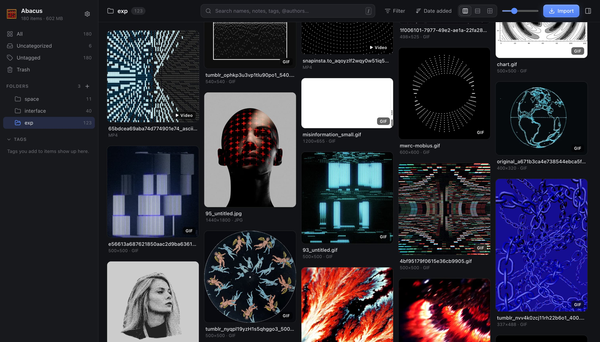

# 🧮 Abacus

Abacus is a self-hosted digital asset management (DAM) system for images, GIFs, videos, and saved posts.
It runs as a web app with a Node.js backend and a SQLite database, and ships as a single Docker image.



## Features

- Grid view with three layouts: waterfall, justified rows, and square grid.
- Nested folders with colors. An item can belong to more than one folder.
- Tags, notes, and 0–5 star ratings.
- Search across names, notes, tags, post text, authors, and URLs.
- Filters by type, source, rating, and color.
- Import from X (Twitter) post links, YouTube, TikTok, Instagram, Reddit, and other sites supported by
  [cobalt](https://github.com/imputnet/cobalt), image and video URLs, web pages, Are.na channel exports, and
  local files.
- A bookmarklet that saves the current page from any browser.
- A full-screen viewer with zoom and keyboard navigation.

## Requirements

- Docker with Docker Compose, or
- Node.js 22.13 or later to run without Docker.

## Run with Docker

1. Clone the repository:

   ```bash
   git clone https://github.com/ferraridavide/abacus.git
   cd abacus
   ```

1. Build and start the container:

   ```bash
   docker compose up -d --build
   ```

1. Open <http://localhost:8080>.

The database, original files, and thumbnails are stored in the `abacus-data` Docker volume.

The compose file also starts a [cobalt](https://github.com/imputnet/cobalt) container, which Abacus uses to
download media from YouTube, TikTok, Instagram, and other sites. It's only reachable from the Abacus container,
and no port is published. To update it, run `docker compose pull cobalt && docker compose up -d cobalt`. To run
without it, delete the `cobalt` service, the `COBALT_URL` variable, and the `depends_on` entry.

## Run locally

1. Install dependencies:

   ```bash
   npm run install:all
   ```

1. Start the API server and the web client:

   ```bash
   npm run dev
   ```

   The API server listens on port 8080 and stores data in `./data`. The web client listens on port 5173
   and proxies API requests to the server.

To import from the sites cobalt supports, start a cobalt container and point the server at it:

```bash
docker run -d --name cobalt -p 127.0.0.1:9000:9000 -e API_URL=http://localhost:9000/ ghcr.io/imputnet/cobalt:11
COBALT_URL=http://localhost:9000 npm run dev
```

To run a production build without Docker:

```bash
npm run build
npm start
```

## Configuration

Set these environment variables in `docker-compose.yml` or in your shell.

| Variable               | Default  | Description                                                                                |
| ---------------------- | -------- | ------------------------------------------------------------------------------------------ |
| `PORT`                 | `8080`   | HTTP port.                                                                                 |
| `DATA_DIR`             | `./data` | Directory for the database, files, and thumbnails.                                         |
| `AUTH_PASSWORD`        | None     | If set, the server requires HTTP basic authentication.                                     |
| `AUTH_USER`            | `abacus` | User name for basic authentication.                                                        |
| `IMPORT_CONCURRENCY`   | `3`      | Number of links fetched in parallel during an import.                                      |
| `MAX_DOWNLOAD_MB`      | `1024`   | Maximum size of a single downloaded or uploaded file.                                      |
| `COBALT_URL`           | None     | URL of a cobalt instance. If unset, links to sites like YouTube are imported as web pages. |
| `COBALT_API_KEY`       | None     | API key, if the cobalt instance requires one.                                              |
| `COBALT_VIDEO_QUALITY` | `1080`   | Maximum video height requested from cobalt, or `max`.                                      |

Per-browser preferences, such as layout, thumbnail size, and video autoplay, are set in **Settings**.

## Search by color

Open **Filter** and use **Search by color** to find images that actually contain a colour, not images that were merely tagged with one.

- **Recommended colors** are a starting set of swatches.
- **Custom color** opens a colour picker for any colour.
- **Color number** accepts a code directly: `#1e88e5`, `1e88e5`, `#f00`, or `rgb(30, 136, 229)`. Press Enter or leave the field to search.

Matching reads the colour codes in the image itself. Each image is indexed as a histogram in OKLab, the perceptual colour space where distance tracks what people see, and results are ranked by how much of the image is that colour. An exact code ranks above a merely similar one, and a small accent of the right colour still matches. Clicking a swatch in the inspector runs the same search.

## Import content

To open the import dialog, click **Import**. You can also drop files or paste links anywhere in the window.

### X posts

Paste one or more post URLs. Abacus detects every post link in the pasted text. Photos are saved at
original resolution, and videos and GIFs are saved as MP4. Posts without media are saved as text cards.
The author, post text, and post date are stored with each item.

Abacus reads posts through X's public embed endpoint and falls back to the public fxtwitter API. Neither
requires an API key. Protected and deleted posts can't be imported.

### YouTube, TikTok, Instagram, and other sites

When `COBALT_URL` is set, Abacus downloads links to any site that the cobalt instance supports, such as
YouTube, TikTok, Instagram, Reddit, Bluesky, Vimeo, and SoundCloud. The **Links** tab of the import dialog
lists the supported sites. Videos are saved as MP4, and posts with several photos or videos are saved as one
item per file. The title, description, and preview image are read from the page. These items have the
**Social** source.

If cobalt doesn't support a link, or the link has no media, Abacus imports it as a web page. If cobalt
supports the site but can't download the post, the import fails with cobalt's error code, for example
`content.video.unavailable`.

Some sites need a login to view public posts. To give cobalt your cookies, create a `cookies.json` file as
described in the [cobalt documentation](https://github.com/imputnet/cobalt/blob/main/docs/run-an-instance.md),
then uncomment `COOKIE_PATH` and the `volumes` entry of the `cobalt` service in `docker-compose.yml`.

### Are.na

1. In Are.na, open a channel and export it as a .zip file.
1. Drop the .zip file into Abacus, or select it on the **Are.na** tab of the import dialog.

Each channel becomes a folder. Block titles, descriptions, source URLs, and dates are kept.

### Bookmarklet

On the **Bookmarklet** tab of the import dialog, drag the **Save to Abacus** button to your bookmarks bar.
Click the bookmark on any page to save that page or post to your library.

Importing the same item twice doesn't create a duplicate.

## Data storage

| Path                     | Contents                       |
| ------------------------ | ------------------------------ |
| `DATA_DIR/library.db`    | SQLite database (WAL mode).    |
| `DATA_DIR/files/<id>/`   | Original files.                |
| `DATA_DIR/thumbs/`       | WebP thumbnails.               |

To back up a library, copy `DATA_DIR` while the server is stopped.
